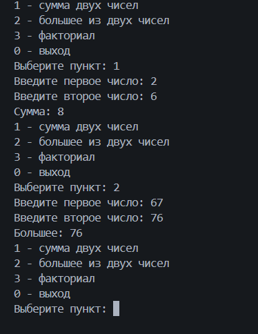
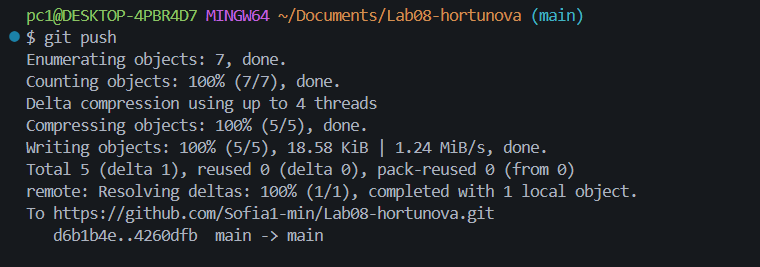

# Практическая работа №8

**ФИО:** Хортюнова София Юрьевна
**Группа:** ИСП-241
**Дата:** 18.10.2026

## Что изучено

- Как создавать методы и вызывать их, чтобы не писать один и тот же код несколько раз.
- Чем отличается метод `void` (просто выполняет действие) от метода с `return` (возвращает результат, который можно сохранить).
- Как передавать данные в метод через параметры, чтобы он мог с ними работать.
## Скриншоты

